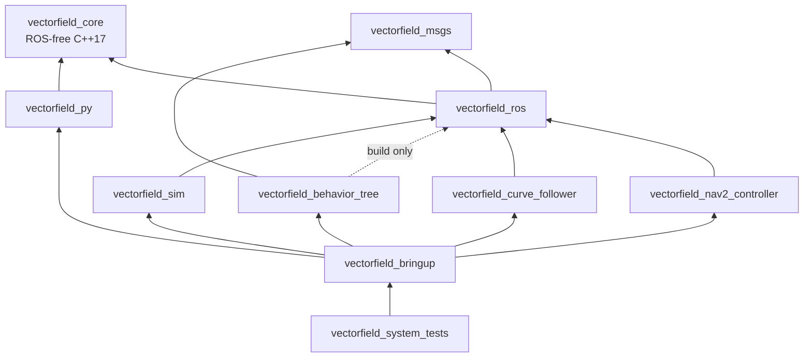

# vectorfield_nav2

[](https://github.com/h3ct0r/vectorfield_nav2/actions/workflows/ci.yml)
[](https://h3ct0r.github.io/vectorfield_nav2/)
[](https://codecov.io/gh/h3ct0r/vectorfield_nav2)
[](LICENSE)

Artificial vector-field navigation for ROS 2 and Nav2. vectorfield_nav2 implements the constructive time-varying vector fields of Rezende, Gonçalves and Pimenta ([IEEE T-RO 2022](https://doi.org/10.1109/TRO.2021.3093674)) as a Nav2 controller plugin and as a standalone curve-following action server, both built on a ROS-free C++ core. The field makes the robot converge to a path or curve and then circulate along it at a set speed; its time-varying feedforward term lets the robot follow curves that move. The implementation is a clean-room C++ rewrite from the equations in the paper and in Rezende's PhD thesis.

> [!NOTE]
> **Status: milestones M0 to M5 are complete; M6 (documentation and the 0.1.0 release) is in progress.** The controller plugin, the curve follower, the simulator and demos, and the Python tools are implemented and tested on Humble, Jazzy and Lyrical. Binary packages follow with 0.1.0; until then, build from source. The [documentation](https://h3ct0r.github.io/vectorfield_nav2/) has a quickstart, the theory, a tuning guide and the parameter reference.

## Features

- **Nav2 controller plugin** `vectorfield_nav2_controller::VectorFieldController` for any Nav2 `controller_server`, with differential, skid-steer, omnidirectional and Ackermann motion models and three tracking laws (feedback linearization, heading tracking, holonomic).
- **Smooth goal handling:** a terminal field that brakes onto the goal, rotate-to-field and rotate-to-heading phases, and cancel support on Jazzy and later.
- **Obstacle handling from the costmap:** collision prediction with a speed cap, a per-cycle blocked status that Nav2's recovery can act on, and optional obstacle contouring (latched circulation around costmap obstacles).
- **`follow_curve` action server** for closed, parametric and moving curves: polylines, muParser expressions in `s` and `t`, and built-in shapes (ellipse, lemniscates, superellipse, Lissajous, rounded rectangle, regular polygon), with laps, moving curve frames and an interlock with Nav2's own actions.
- **RViz and Foxglove visualization** that shows what the robot is doing: the current phase and active flags as colour-coded text, the field broken into the paper's convergence, circulation and feedforward components, the command sent, the predicted trajectory and first collision, the goal and braking zone, and the obstacle-contouring state. Markers are published only while someone subscribes. See the [visualization guide](https://h3ct0r.github.io/vectorfield_nav2/visualization.html).
- **Python bindings and tools** (`vectorfield`, plus `vf-plot`, `vf-sim`, `vf-tune` and `vf-curve`) for plotting fields, simulating and tuning without ROS.
- **Documentation** with the theory, a tuning guide, a generated parameter reference and a [migration guide](https://h3ct0r.github.io/vectorfield_nav2/migration.html) from `vectorfield_stack`.

## Roadmap

| Milestone | Deliverable | Status |
|---|---|---|
| M0 | Scaffolding, community files, devcontainers, pre-commit, CI skeleton, `vectorfield_msgs` 0.x, design notes, docs skeleton | Done |
| M1 | `vectorfield_core`: curves, fields, tracking laws, command limiter, obstacle contouring, collision prediction | Done |
| M2 | `vectorfield_ros` (including the RViz marker builder) and the Nav2 controller plugin | Done |
| M3 | `vectorfield_sim`, controller bringup and demos, system tests | Done |
| M4 | `vectorfield_py` bindings and CLIs, theory pages with generated figures | Done |
| M5 | `vectorfield_curve_follower` (`follow_curve` action), curve demos and example clients | Done |
| M6 | Complete docs, benchmarks, controller comparison, release 0.1.0 | In progress |
| M7 | Optional extensions: CBF obstacle mode, 3D core; done: the `FollowCurve` behaviour-tree node (`vectorfield_behavior_tree`), reversing (plans with cusps) with Nav2 path constraints, and obstacle contouring for Ackermann bases | Optional |

## Packages

| Package | Contents |
|---|---|
| `vectorfield_core` | ROS-free C++17 library (Eigen, vendored muParser): curves, vector fields, tracking laws, command limiter, obstacle contouring, collision prediction. Also builds with plain CMake. |
| `vectorfield_msgs` | `Curve.msg`, `FieldState.msg` and `FollowCurve.action`. |
| `vectorfield_ros` | Shared ROS 2 layer: distro compatibility, conversions, parameters and validation, RViz marker builder. |
| `vectorfield_nav2_controller` | The `nav2_core::Controller` plugin. |
| `vectorfield_curve_follower` | Lifecycle component serving the `follow_curve` action. |
| `vectorfield_behavior_tree` | Nav2 behaviour-tree node `FollowCurve` for the `follow_curve` action, and `bt_runner`. |
| `vectorfield_py` | pybind11 bindings (`vectorfield`) and command-line tools (`vectorfield_tools`). |
| `vectorfield_sim` | Kinematic simulator for headless tests and demos on every distro, including Humble. |
| `vectorfield_bringup` | Launch files, parameter overlays, maps, RViz/Foxglove/PlotJuggler configs, example clients. |
| `vectorfield_system_tests` | Cross-package tests, launch tests and config validation (never released). |
| `vectorfield_nav2` | Metapackage: msgs, core, ros, controller, curve follower, behaviour-tree node, py and sim. |

## Architecture

Package dependencies (an arrow points to the package depended on):



All controller logic lives in `vectorfield_core`, so the Nav2 plugin and the curve follower run the same tracker. No package depends on a package above it; tests that need several packages live in `vectorfield_system_tests`. The `vectorfield_nav2` metapackage groups the released runtime packages and leaves out bringup and system tests.

## Supported ROS 2 distributions

| Distribution | Ubuntu | Nav2 controller API | CI | Status |
|---|---|---|---|---|
| Humble | 22.04 jammy | `setPlan` | every PR (amd64) | Supported |
| Jazzy | 24.04 noble | `setPlan`, plus `cancel` / `reset` | every PR (amd64 with coverage, arm64) | Supported |
| Lyrical | 26.04 resolute | path handler (`newPathReceived`) | every PR (amd64) | Supported |
| Rolling | 26.04 resolute | as Lyrical | nightly, non-gating | Best effort |
| Kilted | 24.04 noble | as Jazzy | none | Unsupported: may build, but has no CI, config or release |

Releases will be made with bloom for Humble, Jazzy and Lyrical, starting with 0.1.0. Nav2 is not released into Rolling, so Rolling is tested against the Nav2 nightly image.

## Quickstart

### Devcontainers (all distros)

Each distribution has its own devcontainer under [`.devcontainer/`](.devcontainer/) (`humble`, `jazzy`, `lyrical`, `rolling`), based on the official `ros:<distro>-ros-base` images (Rolling: the Nav2 nightly image), native on Apple Silicon. Open the repository in VS Code, run **Dev Containers: Reopen in Container** and pick a distribution. Then, from the workspace root (`/ws`):

```bash
colcon build --symlink-install
colcon test && colcon test-result --verbose
```

The Rolling container is for compiling and unit tests only; run demos in the Lyrical container.

### Demo (any distro)

From a sourced workspace, the kinematic simulator demo starts Nav2 with the vector-field controller and RViz with the pre-configured markers; send a goal with **2D Goal Pose**:

```bash
ros2 launch vectorfield_bringup kinematic_sim_demo.launch.py              # every distro
ros2 launch vectorfield_bringup loopback_demo.launch.py                   # Jazzy and later
ros2 launch vectorfield_bringup curve_follower_demo.launch.py             # then:
ros2 run vectorfield_bringup send_curve.py --shape lemniscate_bernoulli --laps 3
```

The [quickstart](https://h3ct0r.github.io/vectorfield_nav2/quickstart.html) lists goals to try and what to look for in RViz. The [tutorials](https://h3ct0r.github.io/vectorfield_nav2/tutorials/getting_started.html) go from a fresh machine to every demo scenario, curve following, offline design with the Python tools, and the [controller on your own robot](https://h3ct0r.github.io/vectorfield_nav2/tutorials/your_robot.html).

### Using the controller

Configure the plugin like any Nav2 controller:

```yaml
controller_server:
  ros__parameters:
    controller_plugins: ["FollowPath"]
    FollowPath:
      plugin: "vectorfield_nav2_controller::VectorFieldController"
      motion_model: differential
      desired_speed: 0.4
      convergence_gain: 2.0
      obstacle_mode: contour
```

Every parameter is in the [parameter reference](https://h3ct0r.github.io/vectorfield_nav2/parameters.html). Annotated templates to copy into your own `nav2_params.yaml` (differential, omnidirectional, Ackermann) are in [`vectorfield_bringup/config/examples/`](vectorfield_bringup/config/examples/).

### Native core build and Python tools (macOS)

`vectorfield_core` and the Python tools build without ROS. With the Homebrew dependencies installed (`brew install cmake ninja eigen googletest google-benchmark`):

```bash
cd vectorfield_core && cmake --preset dev && cmake --build --preset dev && ctest --preset dev
cd .. && python3 -m venv .venv && . .venv/bin/activate
pip install './vectorfield_py[tools]'
vf-sim --model differential --curve ellipse
```

Other core presets: `asan` (ASan + UBSan), `tsan`, `coverage` and `bench`.

## Citation

If you use this software, please cite the method it implements. GitHub's **Cite this repository** button reads [`CITATION.cff`](CITATION.cff), which also lists this implementation.

```bibtex
@article{rezende2022constructive,
  author  = {Rezende, Adriano M. C. and Gon{\c{c}}alves, Vinicius M. and Pimenta, Luciano C. A.},
  title   = {Constructive Time-Varying Vector Fields for Robot Navigation},
  journal = {IEEE Transactions on Robotics},
  year    = {2022},
  volume  = {38},
  number  = {2},
  pages   = {852--867},
  doi     = {10.1109/TRO.2021.3093674}
}

@phdthesis{rezende2022thesis,
  author  = {Rezende, Adriano Martins da Costa},
  title   = {Vector field based guidance and control strategies for robot navigation},
  school  = {Universidade Federal de Minas Gerais},
  address = {Belo Horizonte, Brazil},
  year    = {2022},
  url     = {https://hdl.handle.net/1843/73611}
}
```

## Contributing

See [CONTRIBUTING.md](CONTRIBUTING.md) for the development setup, coding style, tests and the support policy. Please follow the [Code of Conduct](CODE_OF_CONDUCT.md), and report security issues as described in [SECURITY.md](SECURITY.md).

## Credits and license

The method is by Adriano M. C. Rezende, Vinicius M. Gonçalves and Luciano C. A. Pimenta. The design was inspired by [`vectorfield_stack`](https://github.com/adrianomcr/vectorfield_stack), the ROS 1 implementation that accompanies the thesis; no code from it is included. Maintained by Héctor Azpúrua.

Licensed under the [Apache License 2.0](LICENSE). See [NOTICE](NOTICE) for attributions, including the adapted and vendored third-party code (Nav2's FeasiblePathHandler, muParser).
